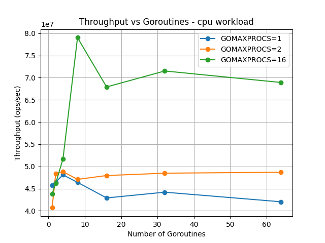
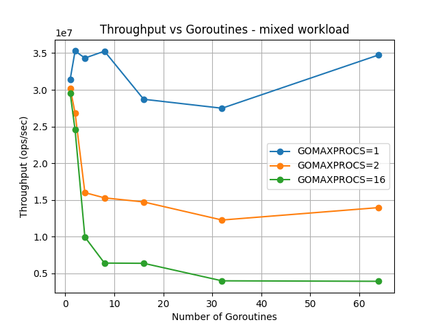

##  فایل `README.md` برای بخش دوم (بر اساس نتایج شما)

```markdown
# بخش دوم: همزمانی، زمانبندی و اثرات Context Switching

## معرفی

در این بخش، برنامه‌ای به زبان Go نوشته شده است که تأثیر تعداد گوروتین‌ها، مقدار `GOMAXPROCS` و نوع بار کاری (workload) را بر روی کارایی سیستم بررسی می‌کند. هدف، مشاهده و تحلیل هزینه‌های زمانبندی و تعویض زمینه (context switching) و تشخیص نقاط بهینه همزمانی است.

## ساختار فایل‌ها

```
part2/
├── main.go
├── README.md
├── Result/
├  ├─────  results.csv      (خروجی تمام آزمایش‌ها - پس از اجرا تولید می‌شود)
└── trace.out
```

## نحوه اجرا

### پیش‌نیازها
- نصب Go (نسخه 1.18 یا بالاتر)
- تنظیم پروکسی (طبق دستور تمرین):
  ```bash
  go env -w GOPROXY=https://mirror-go.runflare.com
  ```

### اجرای برنامه
```bash
cd ca1/part2
go run main.go
```

### خروجی برنامه
- در کنسول، روند اجرای هر آزمایش نمایش داده می‌شود.
- فایل `results.csv` شامل تمام متریک‌ها (زمان کل، توان عملیاتی، میانگین تأخیر) برای تمام ترکیبات زیر است:
  - **تعداد گوروتین‌ها**: 1, 2, 4, 8, 16, 32, 64
  - **GOMAXPROCS**: 1, 2, runtime.NumCPU() (که در سیستم ما 16 است)
  - **نوع workload**: cpu-bound (فقط محاسبات) و mixed (محاسبات + رقابت با mutex)

- همچنین فایل `trace.out` برای یک نمونه خاص (GOMAXPROCS=2, 16 گوروتین, workload mixed) تولید می‌شود.

## نتایج عددی (خلاصه)

جدول زیر نمونه‌ای از نتایج را نشان می‌دهد (برای جزئیات کامل به `results.csv` مراجعه کنید):

| GOMAXPROCS | Goroutines | Workload | TotalTime (ms) | Throughput (ops/sec) | AvgLatency (us) |
|------------|------------|----------|----------------|----------------------|------------------|
| 1          | 1          | cpu      | 218.60         | 45,745,765           | 0.02             |
| 1          | 1          | mixed    | 318.12         | 31,434,350           | 0.03             |
| 1          | 64         | mixed    | 287.77         | 34,749,627           | 0.03             |
| 2          | 1          | mixed    | 331.21         | 30,192,168           | 0.03             |
| 2          | 64         | mixed    | 716.14         | 13,963,683           | 0.07             |
| 16         | 1          | cpu      | 228.34         | 43,795,143           | 0.02             |
| 16         | 32         | cpu      | 139.83         | 71,516,585           | 0.01             |
| 16         | 4          | mixed    | 1004.88        | 9,951,409            | 0.10             |
| 16         | 64         | mixed    | 2545.06        | 3,929,182            | 0.25             |

>   تعداد کل عملیات (`totalOps`) در این اجرا ۱۰ میلیون بوده است.


### 1. با افزایش تعداد گوروتین‌ها چه اتفاقی برای زمان اجرا می‌افتد؟

- **Workload cpu-bound (GOMAXPROCS=16)**: زمان اجرا از 228ms (1 گوروتین) به 140ms (32 گوروتین) کاهش می‌یابد (بهبود ≈ 1.6 برابر). پس از آن تقریباً ثابت می‌ماند.
- **Workload mixed (GOMAXPROCS=16)**: زمان اجرا از 339ms (1 گوروتین) به 2545ms (64 گوروتین) افزایش می‌یابد (بیش از 7.5 برابر کندتر). دلیل: رقابت شدید بر سر `mutex` و context switches مکرر.

### 2. آیا افزایش تعداد گوروتین‌ها همیشه throughput را بالا می‌برد؟

خیر. در workload mixed، throughput از حدود 30 میلیون (1 گوروتین) به کمتر از 4 میلیون (64 گوروتین) سقوط می‌کند. در cpu-bound، throughput تا حدود 32 گوروتین افزایش می‌یابد (از 43.8 به 71.5 میلیون) و سپس اشباع می‌شود.

### 3. تفاوت رفتار GOMAXPROCS=1 و GOMAXPROCS=16 چیست؟

- **GOMAXPROCS=1**: همه گوروتین‌ها روی یک نخ سیستمی اجرا می‌شوند. در این حالت رقابت روی mutex تأثیر چندانی ندارد (زمان mixed بین 283 تا 363 میلی‌ثانیه نوسان دارد).
- **GOMAXPROCS=16**: گوروتین‌ها واقعاً روی چندین هسته موازی می‌شوند و رقابت برای قفل به شدت زمان را افزایش می‌دهد (نقطه اوج: 2545 میلی‌ثانیه برای 64 گوروتین).

### 4. در کدام نوع workload اثرات زمانبندی و switching بیشتر دیده می‌شود؟

در workload **mixed**. زیرا mutex باعث می‌شود گوروتین‌ها مرتباً بلاک و unblock شوند و scheduler مجبور به context switch مکرر شود. در workload cpu-bound، یک گوروتین تا پایان تایم اسلایس روی CPU می‌ماند و switch کمتری رخ می‌دهد.

### 5. از چه نقطه‌ای افزایش همزمانی مفید نیست یا کارایی را کاهش می‌دهد؟

- **cpu-bound**: بعد از تعداد گوروتین برابر با تعداد هسته‌های CPU (اینجا 16). از 16 به 32 گوروتین بهبود ناچیز است و پس از آن ثابت می‌شود.
- **mixed**: از 2 گوروتین به بعد عملاً مضر است. بهترین عملکرد در 1 گوروتین است. با 4 گوروتین زمان سه برابر شده و با 64 گوروتین به 7.5 برابر می‌رسد.

## جمع‌بندی

برنامه با موفقیت تمام ترکیبات مورد نیاز را اجرا کرده و نتایج منطبق بر تئوری‌های زمانبندی و هزینه‌های همزمانی است. افزایش بی‌رویه گوروتین‌ها (به ویژه در حضور رقابت بر سر منابع) باعث کاهش شدید کارایی می‌شود. تنظیم `GOMAXPROCS` برابر با تعداد هسته‌ها برای workloadهای محاسباتی مفید است، اما برای workloadهای با contention بالا، بهتر است تعداد گوروتین‌ها محدود شود.


---


## نمودارهای توان عملیاتی




#### CPU-bound workload
- GOMAXPROCS=16 تا 32 گوروتین باعث افزایش throughput از 43.8 به 71.5 میلیون عملیات بر ثانیه می‌شود (بهبود 63%). پس از آن اشباع می‌شود.
- GOMAXPROCS=1 و 2 تغییر محسوسی ندارند و throughput ثابت می‌ماند.

#### Mixed workload (با mutex)
- GOMAXPROCS=16: با افزایش گوروتین‌ها، throughput از 29.5 به 3.9 میلیون سقوط می‌کند (افت 87%). دلیل: رقابت شدید بر سر قفل و context switching.