# به نام خدا

# تمرین شماره ۲

**اعضای گروه:** سیدعلی تهامی، مهدی وجهی

**شماره دانشجویی:** ۸۱۰۱۰۱۳۹۷ – ۸۱۰۱۰۱۵۵۸

---

# بخش سوم: افزودن مکانیزم Publish/Subscribe و اعلان مصرف حافظه

## 1. مقدمه

در این بخش از تمرین، معماری سیستم توسعه داده شد تا علاوه بر ارتباطات مبتنی بر gRPC، از الگوی ارتباطی Publish/Subscribe نیز پشتیبانی کند. هدف این بخش آشنایی با سیستم‌های رویدادمحور (Event-Driven Systems) و نحوه جداسازی تولیدکنندگان و مصرف‌کنندگان پیام در یک معماری توزیع‌شده است.

برای پیاده‌سازی این قابلیت از Redis Pub/Sub استفاده شد. در این معماری، سرویس وب نقش ناشر (Publisher) را بر عهده دارد و در صورت مشاهده مصرف غیرعادی حافظه، یک پیام هشدار تولید و منتشر می‌کند. از سوی دیگر، یک سرویس مستقل با نام Subscriber به کانال هشدارها متصل شده و تمامی رویدادهای منتشرشده را دریافت و نمایش می‌دهد.

---

# 2. معماری سیستم

در نسخه نهایی سیستم، پنج سرویس مختلف در قالب کانتینرهای Docker اجرا می‌شوند:

1. Redis Broker
2. Auth Server
3. File Server
4. Web Server
5. Subscriber Service

Redis به عنوان Message Broker عمل می‌کند و وظیفه انتقال پیام‌ها میان Publisher و Subscriber را بر عهده دارد.

معماری کلی سیستم به صورت زیر است:

```text
                 +------------------+
                 |   Auth Server    |
                 +------------------+
                          ^
                          |
                        gRPC
                          |
+--------+      +------------------+      +----------------+
| Client | ---> |    Web Server    | ---> |  File Server   |
+--------+      +------------------+      +----------------+
                          |
                          |
                      Publish
                          |
                          v
                 +------------------+
                 |      Redis       |
                 +------------------+
                          |
                      Subscribe
                          |
                          v
                 +------------------+
                 |    Subscriber    |
                 +------------------+
```

در این معماری سرویس وب علاوه بر ایفای نقش دروازه ورود کاربران و برقراری ارتباط با سرویس‌های gRPC، مسئول پایش مصرف حافظه و انتشار هشدارها نیز می‌باشد.

---

# 3. راه‌اندازی سرویس‌ها با Docker Compose

برای استقرار سیستم از Docker Compose استفاده شده است.

سرویس‌های تعریف‌شده عبارت‌اند از:

### Redis

این سرویس از تصویر رسمی Redis نسخه 7 استفاده می‌کند و روی پورت 6379 در دسترس قرار می‌گیرد.

### Auth Server

سرویس احراز هویت که مسئول اعتبارسنجی کاربران است و فایل کاربران را از مسیر `users.json` بارگذاری می‌کند.

### File Server

سرویس مدیریت فایل که امکان دریافت تصاویر و فایل‌ها را فراهم می‌کند.

### Web Server

سرویس اصلی سیستم که رابط کاربری وب را در اختیار کاربران قرار می‌دهد و از طریق gRPC با سرویس‌های دیگر ارتباط برقرار می‌کند.

### Subscriber

سرویس دریافت‌کننده رویدادها که به Redis متصل شده و هشدارهای منتشرشده را دریافت می‌کند.

---

# 4. مکانیزم پایش حافظه

برای اندازه‌گیری مصرف حافظه از بسته استاندارد `runtime` در زبان Go استفاده شده است.

در هنگام راه‌اندازی Web Server، یک Goroutine مستقل اجرا می‌شود:

```go
go monitorMemory()
```

این Goroutine به صورت همزمان با پردازش درخواست‌های کاربران فعالیت می‌کند و وظیفه آن پایش وضعیت حافظه است.

فرآیند پایش هر پنج ثانیه یک بار اجرا می‌شود:

```go
ticker := time.NewTicker(5 * time.Second)
```

در هر چرخه، اطلاعات حافظه از ساختار `runtime.MemStats` استخراج می‌شود:

```go
runtime.ReadMemStats(&m)
```

سپس میزان حافظه تخصیص‌یافته محاسبه می‌گردد:

```go
allocMB := m.Alloc / 1024 / 1024
```

---

# 5. آستانه هشدار

مطابق پیاده‌سازی انجام‌شده، آستانه مصرف حافظه برابر 300 مگابایت تعریف شده است:

```go
const memoryThresholdMB uint64 = 300
```

هرگاه حافظه مصرفی از این مقدار عبور کند، سیستم یک هشدار تولید می‌کند.

شرط تولید هشدار:

```go
if allocMB > memoryThresholdMB
```

---

# 6. ساختار رویداد منتشرشده

برای انتقال اطلاعات هشدار، ساختاری با نام `MemoryEvent` تعریف شده است.

این ساختار شامل اطلاعات زیر است:

| فیلد        | توضیح             |
| ----------- | ----------------- |
| EventType   | نوع رخداد         |
| Service     | نام سرویس         |
| MemoryMB    | میزان حافظه مصرفی |
| ThresholdMB | مقدار آستانه      |
| Timestamp   | زمان وقوع رخداد   |

نمونه پیام تولیدشده:

```json
{
  "event_type": "HIGH_MEMORY_USAGE",
  "service": "web-server",
  "memory_mb": 350,
  "threshold_mb": 300,
  "timestamp": "2026-06-01T12:30:00Z"
}
```

---

# 7. انتشار پیام در Redis

پس از تولید رخداد، داده‌ها به JSON تبدیل می‌شوند:

```go
payload, _ := json.Marshal(event)
```

سپس در کانال `memory_alerts` منتشر می‌شوند:

```go
redisClient.Publish(
    ctx,
    "memory_alerts",
    payload,
)
```

در این بخش Web Server نقش Publisher را ایفا می‌کند.

---

# 8. افزایش عمدی مصرف حافظه

برای آزمایش سیستم یک Endpoint اختصاصی طراحی شده است:

```text
/consume-memory
```

این Endpoint یک پارامتر به نام `mb` دریافت می‌کند:

```text
http://localhost:8080/consume-memory?mb=100
```

در این مثال، برنامه 100 مگابایت حافظه جدید تخصیص می‌دهد.

حافظه توسط آرایه‌های بایتی ایجاد می‌شود:

```go
chunk := make([]byte, mb*1024*1024)
```

برای جلوگیری از آزاد شدن حافظه توسط Garbage Collector، آرایه‌ها در متغیر سراسری زیر نگهداری می‌شوند:

```go
memoryHog [][]byte
```

در نتیجه با هر بار فراخوانی Endpoint، مصرف حافظه به صورت تجمعی افزایش پیدا می‌کند.

---

# 9. سرویس Subscriber

<div dir="rtl">
Subscriber یک سرویس مستقل است که وظیفه دریافت هشدارهای منتشرشده را بر عهده دارد.

در ابتدای اجرا، این سرویس به Redis متصل می‌شود:
</div>

```go
rdb := redis.NewClient(...)
```

سپس در کانال هشدارها عضو می‌شود:

```go
pubsub := rdb.Subscribe(
    ctx,
    "memory_alerts",
)
```

تمامی پیام‌های دریافتی از کانال توسط حلقه زیر پردازش می‌شوند:

```go
for msg := range ch
```

هر پیام ابتدا از JSON به ساختار `MemoryEvent` تبدیل می‌شود:

```go
json.Unmarshal(...)
```

و سپس برای نمایش به تابع `printAlert` ارسال می‌گردد.

---

# 10. نمایش هشدار

هشدارهای دریافتی به شکل خوانا در خروجی ترمینال نمایش داده می‌شوند.

نمونه خروجی:

```text
==================================================
ALERT: HIGH_MEMORY_USAGE
==================================================
Service:    web-server
Memory:     345 MB (Threshold: 300 MB)
Timestamp:  2026-06-01T12:30:00Z
==================================================
```

این قالب باعث می‌شود رویدادهای مهم به سادگی در میان لاگ‌های سیستم قابل مشاهده باشند.

---

# 11. سناریوی تست

برای اعتبارسنجی عملکرد سیستم، مراحل زیر اجرا شد.

## مرحله 1: راه‌اندازی Redis

ابتدا سرویس Redis اجرا شد.

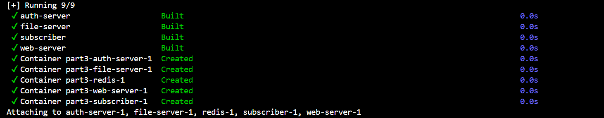

---

## مرحله 2: اجرای Auth Server

سرویس احراز هویت راه‌اندازی شد.

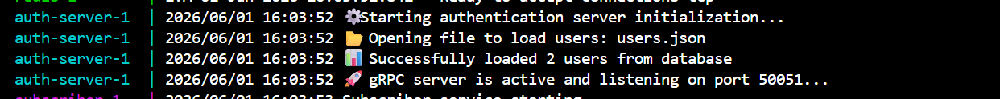

---

## مرحله 3: اجرای File Server

سرویس فایل اجرا شد.

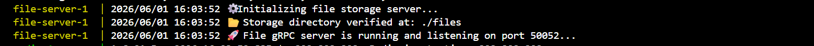

---

## مرحله 4: اجرای Web Server

وب‌سرور راه‌اندازی شد.

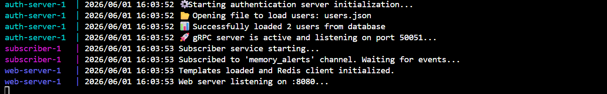

```text
Web server listening on :8080
```

---

## مرحله 5: اجرای Subscriber

سرویس Subscriber اجرا شد.


```text
Subscriber service starting...
Subscribed to 'memory_alerts' channel.
```

---

## مرحله 6: نمایش فرم ورود

کاربر صفحه ورود را در مرورگر باز می‌کند.

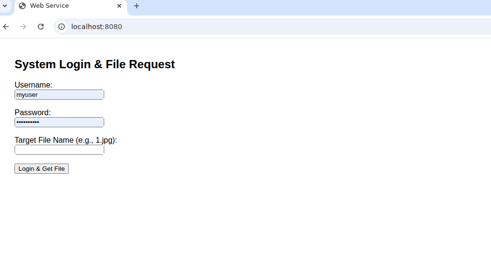

---

## مرحله 7: ورود ناموفق

ورود با اطلاعات اشتباه انجام می‌شود.

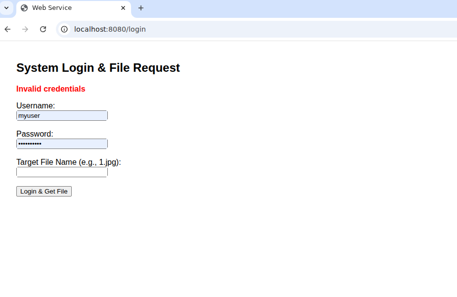

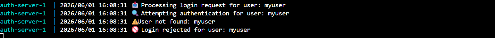

---

## مرحله 8: ورود موفق

ورود با اطلاعات معتبر انجام می‌شود.

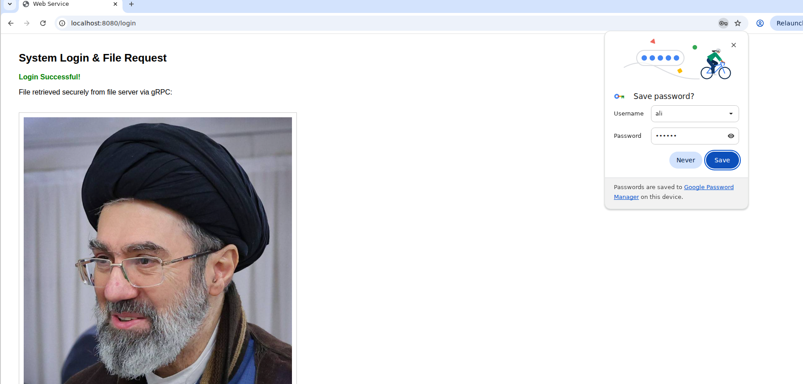

---

## مرحله 9: دریافت تصویر از File Server

تصویر از سرویس فایل دریافت و نمایش داده می‌شود.


---

## مرحله 10: افزایش مصرف حافظه

در ترمینال دستور زیر اجرا می‌شود:

```bash
curl "http://localhost:8080/consume-memory?mb=100"
curl "http://localhost:8080/consume-memory?mb=100"
curl "http://localhost:8080/consume-memory?mb=150"
```

در نتیجه بیش از 300 مگابایت حافظه تخصیص داده می‌شود.

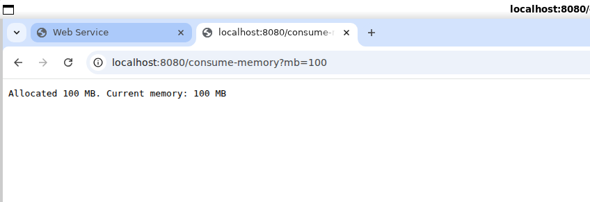
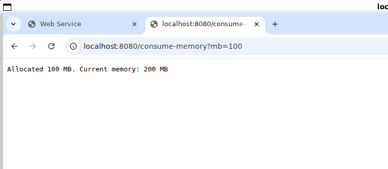
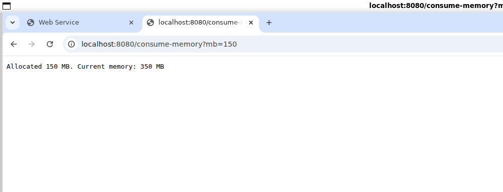


---

## مرحله 11: تولید هشدار

Web Server عبور از آستانه 300 مگابایت را تشخیص می‌دهد.

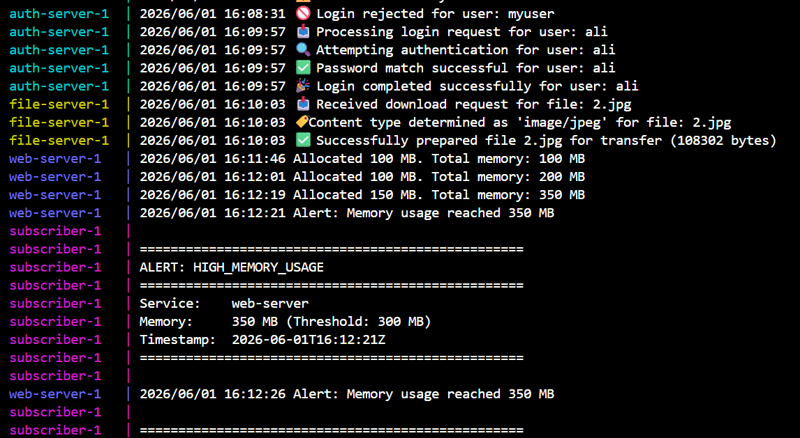

```text
Alert: Memory usage reached ...
```

---

## مرحله 12: دریافت هشدار توسط Subscriber

Subscriber پیام را از Redis دریافت می‌کند.


---

# 12. نتیجه‌گیری

در این بخش یک سامانه Publish/Subscribe مبتنی بر Redis طراحی و پیاده‌سازی شد. سرویس Web Server به صورت دوره‌ای مصرف حافظه خود را پایش می‌کند و در صورت عبور از آستانه 300 مگابایت، یک رخداد از نوع `HIGH_MEMORY_USAGE` در کانال `memory_alerts` منتشر می‌نماید. سرویس Subscriber نیز با عضویت در این کانال تمامی هشدارها را به صورت بلادرنگ دریافت و نمایش می‌دهد.

این پیاده‌سازی نمونه‌ای عملی از معماری‌های رویدادمحور در سیستم‌های توزیع‌شده است و نشان می‌دهد چگونه می‌توان بدون وابستگی مستقیم میان سرویس‌ها، اطلاعات و هشدارها را در سطح سیستم توزیع و مدیریت کرد.

</div>
